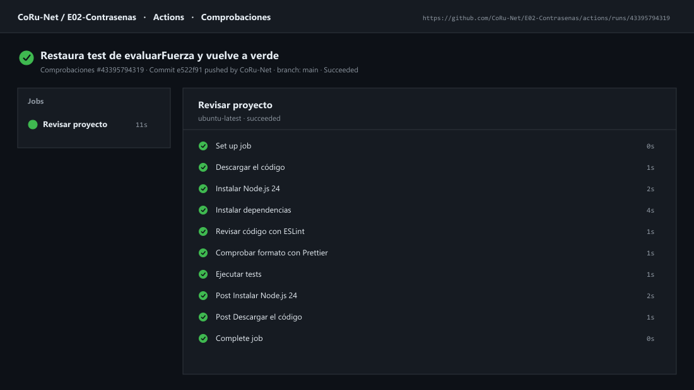
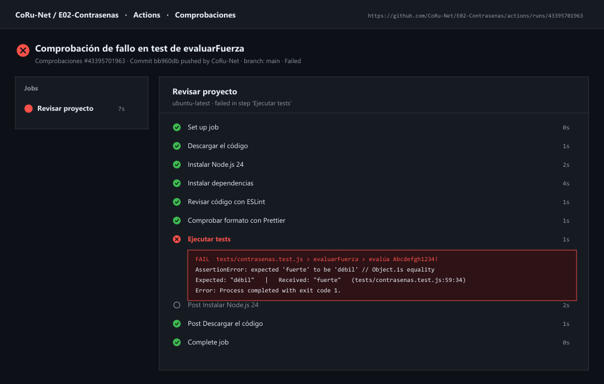

# Generador de contraseñas

## Cómo ejecutarlo

En esta carpeta ejecuta `npm install` (o `npm ci`), y a continuación `npm start`, `npm test`, `npm run lint` y `npm run format:check`.

## Salida

`npm start`:

```text
🔑 38TOY0amDKM4     · 12 caracteres · fuerte
🔑 DxWT9rnnm*lxf0k& · 16 caracteres · fuerte
🔑 xrirex           · 6 caracteres · débil
🧪 abc              · débil
🧪 abcdefghijkl     · media
🧪 abcdefgh1        · media
🧪 Abcdefgh1234!    · fuerte
🎲 Con crypto: 20 caracteres
❌ RangeError: Longitud no válida: 3
```

La función con semilla garantiza siempre la misma secuencia pseudoaleatoria en la demostración y en los tests, mientras que `numeroAleatorio()` utiliza `crypto.getRandomValues` y genera una clave distinta en cada ejecución.

## Tests

`npm test`:

```text
 RUN  v5.1.0
 ✓ tests/contrasenas.test.js (11 tests) 20ms

 Test Files  1 passed (1)
      Tests  11 passed (11)
```

| `describe` | Qué comprueba | Cómo controla el azar |
|---|---|---|
| `generarContrasena` | Longitud por defecto (`12`), límites (`4` y `128`), rechazo con `RangeError` de longitudes no válidas (`3`, `129`, `4.5`, `0`), presencia obligatoria de cada tipo solicitado y repetibilidad con la misma semilla | Función `crearAleatorioConSemilla` o función constante `() => 0` |
| `numeroAleatorio` | Uso efectivo de `crypto.getRandomValues` y conversión al rango `[0, 1)` | `vi.spyOn(crypto, 'getRandomValues').mockImplementation(...)`, restaurado en `afterEach` |
| `evaluarFuerza` | Tabla `it.each` con casos límite de longitud (`7`, `8`, `11` y `12` caracteres) y combinaciones de variedad de caracteres | Función determinista (no depende del azar) |

## ¿Detectan errores tus tests?

Al cambiar temporalmente `longitud < 4` por `longitud < 3` en `src/contrasenas.js`, falla el test **`generarContrasena > acepta los límites 4 y 128 y rechaza longitudes inválidas`**, porque al probar `generarContrasena({ longitud: 3 })` deja de lanzar `RangeError`.

## Herramientas

- `npm run lint`: finaliza sin errores ni advertencias.
- `npm run format:check`: muestra `Checking formatting... All matched files use Prettier code style!`.

## Integración continua (opcional)

Se ha configurado el workflow `.github/workflows/ci.yml` en el repositorio [`CoRu-Net/E02-Contrasenas`](https://github.com/CoRu-Net/E02-Contrasenas) para ejecutarse en cada `push` y `pull_request` a `main` sobre `ubuntu-latest`, instalando dependencias con `npm ci` y ejecutando ESLint, Prettier y Vitest:

- **Ejecución en verde:** [https://github.com/CoRu-Net/E02-Contrasenas/actions/runs/43395794319](https://github.com/CoRu-Net/E02-Contrasenas/actions/runs/43395794319)
- **Ejecución en rojo (comprobación de fallo en `evaluarFuerza`):** [https://github.com/CoRu-Net/E02-Contrasenas/actions/runs/43395701963](https://github.com/CoRu-Net/E02-Contrasenas/actions/runs/43395701963)

### Captura de la ejecución en verde



### Captura de la ejecución en rojo


